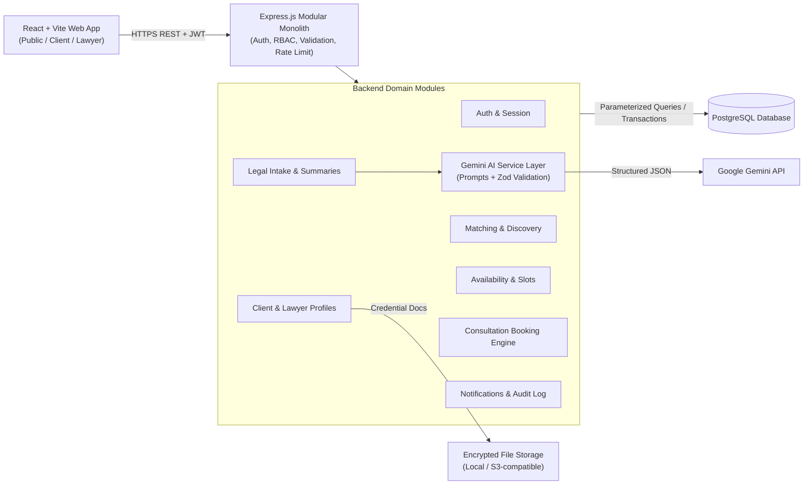
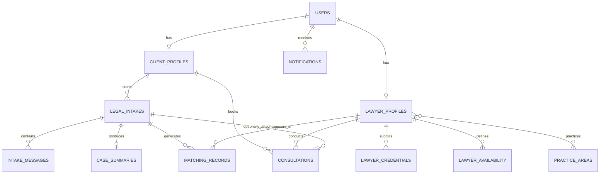

# VAKAALAT (वकालत) — System Architecture

## 1. Architectural Philosophy

Vakaalat is built as a **Modular Monolith** with strict domain boundaries and a single source of truth in PostgreSQL.

- **AI Boundary Principle:** **Gemini AI** handles natural-language understanding, clarifying questions, neutral case summarization, and practice-area suggestions. **The Backend** owns all truth, state transitions, permissions, availability calculations, booking transactions, and credential verification. AI output never directly mutates critical business records without backend validation and explicit user/system confirmation.

---

## 2. High-Level Architecture Diagram



---

## 3. Frontend Structure (`frontend/`)

Built with **React 18+**, **TypeScript**, **Vite**, and **Tailwind CSS** (configured with CSS custom property design tokens).

```text
frontend/src/
├── app/                    # Router, AuthProvider, ThemeProvider, QueryClient
├── components/
│   ├── ui/                 # Design system primitives (Button, Input, Card, Modal, Badge, Table)
│   └── layout/             # PublicNavbar, WorkspaceSidebar, AuthSplitLayout
├── features/
│   ├── public/             # Landing, HowItWorks, PracticeAreas, About
│   ├── auth/               # Login, Register, RoleGuard
│   ├── intake/             # StartEnquiry, ConversationalIntake, CaseSummaryView
│   ├── discovery/          # LawyerSearch, LawyerFilters, LawyerProfile, CompareDrawer
│   ├── consultations/      # SlotPicker, BookingModal, ConsultationList
│   └── lawyer/             # LawyerDashboard, CredentialUpload, AvailabilityManager, RequestQueue
├── lib/                    # API client (fetch/axios + token refresh), formatters, validators
└── types/                  # Shared TypeScript interfaces matching API DTOs
```

- **Route Protection:** `ProtectedRoute` verifies authenticated user + `role === 'client' | 'lawyer' | 'admin'` before rendering workspace shells.

---

## 4. Backend Modular Monolith (`backend/`)

Built with **Node.js**, **Express.js**, **TypeScript**, **Zod** (request & AI output validation), and **PostgreSQL** (`pg` / Prisma or Drizzle ORM).

```text
backend/src/
├── config/                 # Env validation (Zod), DB pool, Gemini client config
├── middleware/             # authenticateJWT, requireRole, validateRequest, errorHandler, rateLimiter
├── modules/
│   ├── auth/               # Register, login, refresh token rotation, password hashing (argon2/bcrypt)
│   ├── users/              # User account & privacy settings
│   ├── clients/            # Client profile management
│   ├── lawyers/            # Lawyer profile, practice areas, credential submission & admin verification
│   ├── practice-areas/     # Master taxonomy of Indian legal practice areas
│   ├── intakes/            # Legal intake lifecycle & intake messages
│   ├── ai/                 # Dedicated Gemini service, prompt templates, schema validation, fallbacks
│   ├── matching/           # Deterministic DB matching + persisted matching_records
│   ├── availability/       # Recurring weekly rules, date overrides, real-time slot generation
│   ├── consultations/      # Transactional booking, accept/decline, cancel/reschedule state machine
│   ├── notifications/      # In-app notifications (and email/SMS hook readiness)
│   └── audit/              # Immutable audit log writer for sensitive operations
└── server.ts               # Express app bootstrap & graceful shutdown
```

---

## 5. Database Design & Entity-Relationship Diagram

### 5.1 Core Entities (12 Domain Tables + Operational Tables)

1. **`users`**: `id (UUID PK)`, `email (unique)`, `password_hash`, `role ('client' | 'lawyer' | 'admin')`, `full_name`, `phone`, `is_active`, `created_at`, `updated_at`.
2. **`client_profiles`**: `id (UUID PK)`, `user_id (FK -> users, unique)`, `city`, `state`, `preferred_language`, `privacy_consent_at`.
3. **`lawyer_profiles`**: `id (UUID PK)`, `user_id (FK -> users, unique)`, `headline`, `bio`, `qualifications`, `experience_years`, `city`, `state`, `chamber_address`, `languages (text[])`, `consultation_modes (text[])`, `consultation_fee_inr`, `slot_duration_mins`, `verification_status ('unverified' | 'pending' | 'verified' | 'rejected')`, `is_accepting_consultations`.
4. **`lawyer_credentials`**: `id (UUID PK)`, `lawyer_id (FK -> lawyer_profiles)`, `bar_council_number`, `state_bar_council`, `enrollment_year`, `document_url`, `status ('pending' | 'approved' | 'rejected')`, `reviewer_notes`, `reviewed_by (FK -> users)`, `reviewed_at`.
5. **`practice_areas`**: `id (UUID PK)`, `slug (unique)`, `name`, `hindi_name`, `description`, `is_active`.
   - Join table **`lawyer_practice_areas`**: `(lawyer_id, practice_area_id)`.
6. **`legal_intakes`**: `id (UUID PK)`, `client_id (FK -> client_profiles)`, `reference_code (unique, e.g. VK-2026-0001)`, `city`, `initial_description`, `status ('draft' | 'in_progress' | 'summarized' | 'matched' | 'archived')`, `consent_accepted_at`, `created_at`, `updated_at`.
7. **`intake_messages`**: `id (UUID PK)`, `intake_id (FK -> legal_intakes)`, `sender ('client' | 'ai' | 'system')`, `content`, `structured_metadata (JSONB)`, `created_at`.
8. **`case_summaries`**: `id (UUID PK)`, `intake_id (FK -> legal_intakes, unique)`, `neutral_summary`, `key_facts (JSONB)`, `missing_info_questions (JSONB)`, `suggested_practice_area_ids (UUID[])`, `ai_confidence_notes`, `client_edited_summary`, `is_ai_generated`, `created_at`, `updated_at`.
9. **`lawyer_availability`**: `id (UUID PK)`, `lawyer_id (FK -> lawyer_profiles)`, `rule_type ('weekly' | 'override')`, `day_of_week (0-6, nullable)`, `specific_date (date, nullable)`, `start_time (time)`, `end_time (time)`, `is_available (boolean)`.
10. **`consultations`**: `id (UUID PK)`, `client_id (FK -> client_profiles)`, `lawyer_id (FK -> lawyer_profiles)`, `intake_id (FK -> legal_intakes, nullable)`, `scheduled_date (date)`, `start_time (time)`, `end_time (time)`, `mode ('in_person' | 'video' | 'phone')`, `status ('requested' | 'confirmed' | 'declined' | 'cancelled_by_client' | 'cancelled_by_lawyer' | 'completed')`, `share_case_summary (boolean)`, `decline_or_cancel_reason`, `created_at`, `updated_at`.
    - **Concurrency Constraint:** Partial unique index on `(lawyer_id, scheduled_date, start_time)` WHERE `status IN ('requested', 'confirmed')` to guarantee zero double-booking at the database level.
11. **`matching_records`**: `id (UUID PK)`, `intake_id (FK -> legal_intakes)`, `lawyer_id (FK -> lawyer_profiles)`, `matched_practice_area_id (FK -> practice_areas)`, `match_reasons (JSONB)`, `created_at`.
12. **`notifications`**: `id (UUID PK)`, `user_id (FK -> users)`, `type`, `title`, `body`, `link_url`, `is_read`, `created_at`.
13. **Operational Tables:** `refresh_tokens` (hashed token rotation) and `audit_logs` (`actor_id`, `action`, `entity_type`, `entity_id`, `metadata`, `created_at`).

### 5.2 Entity-Relationship Diagram



---

## 6. REST API Boundaries

All endpoints are prefixed with `/api/v1` and return consistent JSON envelopes (`{ data, meta }` or `{ error: { code, message, details } }`).

- **Public:**
  - `GET /practice-areas`
  - `GET /lawyers` (supports `?city=Kanpur&practiceArea=...&language=...&mode=...&verifiedOnly=true`)
  - `GET /lawyers/:id` & `GET /lawyers/:id/slots?date=YYYY-MM-DD`
- **Auth:**
  - `POST /auth/register`, `POST /auth/login`, `POST /auth/refresh`, `POST /auth/logout`, `GET /auth/me`
- **Client (`/client/*`, requires `CLIENT` role):**
  - `POST /intakes`, `GET /intakes`, `GET /intakes/:id`, `POST /intakes/:id/messages`, `POST /intakes/:id/summarize`, `PATCH /intakes/:id/summary`
  - `GET /intakes/:id/matches`
  - `POST /consultations`, `GET /consultations`, `PATCH /consultations/:id/cancel`
- **Lawyer (`/lawyer/*`, requires `LAWYER` role):**
  - `PUT /lawyer/profile`, `POST /lawyer/credentials`, `PUT /lawyer/practice-areas`
  - `GET /lawyer/availability`, `PUT /lawyer/availability`
  - `GET /lawyer/consultations`, `PATCH /lawyer/consultations/:id/respond` (`accept` | `decline`)
- **Admin (`/admin/*`, requires `ADMIN` role):**
  - `GET /admin/credentials?status=pending`, `PATCH /admin/credentials/:id/verify`

---

## 7. Gemini AI Integration Design

- **Service Isolation:** Only `modules/ai/` communicates with the Gemini SDK (`GEMINI_API_KEY` stored exclusively in server environment variables).
- **Structured JSON Outputs:** Gemini is invoked with strict JSON schema instructions for two operations:
  1. `analyzeIntakeTurn`: Extracts known facts (`timeline`, `parties`, `location`, `issue_type`), identifies missing information, and generates 1–2 concise, empathetic follow-up questions.
  2. `generateCaseSummary`: Produces `neutral_summary`, `key_facts[]`, `suggested_practice_areas[]` (constrained to canonical slugs from `practice_areas` table), and `uncertainty_notes`.
- **Guardrails & Validation:**
  - System prompt explicitly forbids giving legal advice, citing guaranteed outcomes, or impersonating an advocate.
  - Every Gemini response is parsed and validated through **Zod**. Invalid or malformed responses trigger a single retry or a graceful deterministic fallback (prompting the user to select practice areas manually while preserving their written facts).

---

## 8. Booking & Availability Concurrency Workflow

1. **Slot Generation:** `GET /lawyers/:id/slots` computes open slots on the fly from `lawyer_availability` (weekly rules minus `override` blocks) minus active `consultations` (`requested` or `confirmed`).
2. **Atomic Booking (`POST /consultations`):**
   - Runs inside a PostgreSQL transaction (`BEGIN ... COMMIT`).
   - Verifies the lawyer is `verified` and `is_accepting_consultations = true`.
   - Verifies the requested slot matches an active availability window.
   - Inserts into `consultations` with `status = 'requested'`. The partial unique index rejects concurrent duplicate bookings with `409 Conflict`.
   - Creates a notification for the lawyer.

---

## 9. Privacy, Security & Multi-City Scalability

- **Authentication & Passwords:** `argon2id` (or `bcrypt` cost ≥ 12) password hashing; short-lived JWT access tokens (15m) + HttpOnly Secure SameSite refresh cookies.
- **Authorization & Case Privacy:** Ownership middleware checks `intake.client_id === req.user.clientProfileId` on every intake/summary read. Lawyers can **only** view a `case_summary` if a consultation exists AND `consultation.share_case_summary === true`.
- **Auditability:** Credential approvals, verification changes, consultation status transitions, and account deletions are recorded in `audit_logs`.
- **Multi-City Expansion:** `city` and `state` are indexed columns on `lawyer_profiles`, `legal_intakes`, and discovery queries. Expanding from Kanpur to Lucknow, Varanasi, or Delhi requires adding city configuration and seed/onboarded lawyers—no schema changes.
